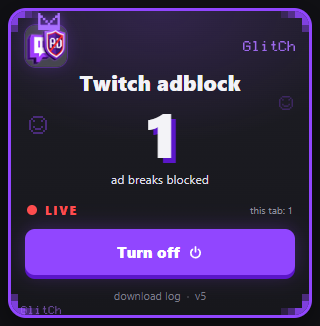

# Twitch adblock

> **[English](README.md)** | **[Русская версия](README.ru.md)**

A Chrome / Edge extension (Manifest V3) that removes **server-side stitched ads (SSAI)** from Twitch streams.

*Расширение для Chrome и Edge (Manifest V3), убирающее серверную рекламу (SSAI) из стримов Twitch без отдельного плеера и потери качества. Полное русскоязычное описание доступно в [README.ru.md](README.ru.md).*

<p align="center">
  
</p>

Twitch stitches ads right into the HLS playlist served from the same CDN as the stream, so classic domain blocking does nothing. This extension rewrites the playlist before the player ever sees it — no separate player, no quality loss, no video re-encoding.

## Features

- **Three independent blocking layers** — a clean master playlist, ad-segment stripping, and a DVR-tail fallback.
- **Live counter** of blocked ad breaks in the popup.
- **On/off toggle** that takes effect immediately, no page reload.
- **English and Russian UI**, picked automatically from the browser language.
- **No telemetry, no external servers.** Diagnostics stay in `chrome.storage.local`.

## How it works

Twitch does not fetch `.m3u8` from the page — the request is made **inside a blob Web Worker** owned by the player. Page-level `fetch`/`XHR` hooks see nothing.

The extension does three things:

1. **Patches `window.Worker`** (MAIN world, `document_start`) and rebuilds the worker source with a small patch prepended. The patch is recursive: if the loader creates a nested worker, that one gets patched too.
2. **Intercepts `fetch` inside the worker**:
   - **Layer 1 (primary).** A request for the master playlist `usher.ttvnw.net/api/v2/channel/hls/<channel>.m3u8` is replaced with the same request carrying an access token issued by GQL for `playerType=embed`. For non-primary players Twitch serves the stream **without ads at all** — nothing to strip, no A/V desync.
   - **Layer 2 (fallback).** If ad markers still show up (`CLASS="twitch-stitched-ad"`, `CLASS="twitch-ad-quartile"`), ad segments are cut out of the playlist body: `#EXTINF:2.002,Amazon|...` entries with their URIs, ad `#EXT-X-DATERANGE`, ad `#EXT-X-MAP`/`#EXT-X-DISCONTINUITY`, and `#EXT-X-TWITCH-PREFETCH`.
     **Black-screen guard:** if stripping leaves zero `live` segments (a pure preroll), the **original** playlist is returned — an ad is better than a dead player.
   - **Layer 3 (if layer 1 fails).** Twitch records the stream to a DVR playlist on the CDN, and **that one has no ads** (SSAI is only stitched at the live edge). The extension finds `https://{server}.cloudfront.net/{sha1(base)[:20]}_{base}/{quality}/index-dvr.m3u8` (`base = {login}_{streamId}_{startUnix}`), takes the last 12 segments (2 minutes) and serves them as a live playlist: absolute `MEDIA-SEQUENCE`, `TWITCH-LIVE-SEQUENCE`, `ELAPSED/TOTAL-SECS`, `EXTINF:...,live`. The tail is **rebuilt on every player request**, so the window slides with the live edge. Verified: 120 s of continuous 720p60 video without ads.
3. **Diagnostics** are exposed on `window.__adstrip` in the page console.

## Install

1. Open `chrome://extensions` and enable **Developer mode**.
2. Click **Load unpacked** and select the folder that contains `manifest.json`.
3. Open Twitch and reload the page.

> Works in Chrome, Edge and other Chromium-based browsers. Firefox is not supported (MV3 `world: "MAIN"` and the worker patch are Chromium-specific).

## Popup

- **Big number** — total ad breaks blocked.
- **LIVE / OFF** — current state.
- **this tab: N** — blocked in the current tab.
- **Turn on / Turn off** — toggles blocking instantly.
- **download log · v5** — exports diagnostics as JSON (hover shows `checks / ad segments`).

The UI language follows the browser (`_locales/en`, `_locales/ru`).

## Diagnostics: was there an ad at all?

`cleanMasters: 1` alone proves nothing — maybe there was no ad to begin with. So at the moment of interception the extension **also** requests the normal (`playerType=site`) stream from Twitch and counts ad segments in it. That stream is never handed to the player; it is a measurement only.

The result is stored in `window.__adstrip.checks` and printed to the console:

```
[Twitch adblock] PROBE somechannel: normal (site) stream has ad segments=6
                 (variants checked: 2) -> AD WAS SERVED, player never got it
```

or

```
[Twitch adblock] PROBE somechannel: normal (site) stream has ad segments=0
                 (variants checked: 2) -> no ad at this moment
```

| Field | Meaning |
|---|---|
| `checks[].adSegs` | how many ad segments Twitch was ready to serve right now |
| `checks[].liveSegs` | how many regular segments the same playlist had |
| `checks[].stitched` | whether `CLASS="twitch-stitched-ad"` was present |
| `checks[].checked` | how many quality variants were checked |

Full log (every interception and error):

```js
window.__adstripDump()
```

Limitation: this is one probe per channel per session, taken when the player starts. A later midroll will not appear in `checks` — but layer 2 will still catch it (`strippedSegs`).

## Limitations

- `playerType=embed` is undocumented Twitch behaviour and can be closed at any moment.
- On a pure preroll (ads only, zero live segments) layer 2 deliberately returns the original playlist, so the ad **is shown** — better than a black screen.
- Layer 3 lags ~1.5–2 minutes behind live and serves a single quality (720p60 when available). That is the price of the fallback.
- The DVR playlist does not exist for every channel (depends on stream settings), so layer 3 is a fallback, not the main path.
- Token requests add ~200–400 ms to playback start.
- The extension is loaded unpacked (no store release yet).

## Development

The extension itself has no build step and no dependencies.

```bash
git clone https://github.com/Davidson235/twitch-adblock.git
cd twitch-adblock
```

Load the folder as an unpacked extension. After editing `content.js` or `manifest.json`, hit reload on the extension card in `chrome://extensions`.

### Packaging

Build a store-ready zip:

```powershell
powershell -File scripts/build.ps1
# -> dist/twitch-adblock-<version>.zip
```

Pushing a `v*` tag triggers `.github/workflows/release.yml`, which builds the zip and attaches it to the GitHub release.

## Privacy

- No analytics, no remote config, no third-party requests.
- The only network traffic is the one Twitch itself makes, plus the `playerType=site` probe used to verify that an ad was really there.
- Settings and counters live in `chrome.storage.local` and never leave the machine.

## License

[MIT](LICENSE)
