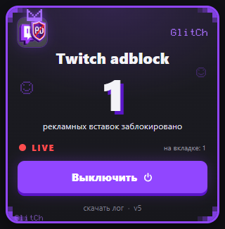

# Twitch adblock

> **[Русский](README.ru.md)** | **[English version](README.md)**

Расширение для Chrome / Edge (Manifest V3), которое убирает **серверную рекламу (SSAI)** из трансляций Twitch.

<p align="center">
  
</p>

Twitch вставляет рекламу прямо в HLS-плейлист на том же CDN, что и сам стрим, поэтому обычная блокировка доменов бесполезна. Расширение переписывает плейлист до того, как его увидит плеер — без отдельного плеера, без потери качества и без перекодирования видео.

## Возможности

- **Три независимых слоя блокировки** — чистый мастер-плейлист, вырезание ad-сегментов и DVR-хвост как страховка.
- **Живой счётчик** заблокированных вставок в popup.
- **Тумблер вкл/выкл**, срабатывает сразу, без перезагрузки страницы.
- **Русский и английский интерфейс** — выбирается по языку браузера.
- **Никакой телеметрии и внешних серверов.** Диагностика хранится только в `chrome.storage.local`.

## Как это работает

Twitch тянет `.m3u8` **не из страницы, а изнутри blob-воркера** плеера. Поэтому страничные `fetch`/`XHR`-хуки ничего не видят.

Расширение делает три вещи:

1. **Подменяет `window.Worker`** (MAIN world, `document_start`) и пересобирает исходник воркера, добавляя перед ним свой патч. Патч рекурсивный — если воркер-загрузчик создаёт вложенный воркер, тот тоже патчится.
2. **Внутри воркера перехватывает `fetch`**:
   - **Слой 1 (основной).** Запрос мастер-плейлиста `usher.ttvnw.net/api/v2/channel/hls/<channel>.m3u8` подменяется на такой же запрос, но с access-token, выданным GQL для `playerType=embed`. Twitch для неосновных плееров отдаёт поток **без рекламы вообще** — ничего не нужно вырезать и нет рассинхрона.
   - **Слой 2 (fallback).** Если в ответе всё же встречаются ad-маркеры (`CLASS="twitch-stitched-ad"`, `CLASS="twitch-ad-quartile"`), ad-сегменты вырезаются из тела плейлиста: удаляются `#EXTINF:2.002,Amazon|...` вместе с URI, ad-`#EXT-X-DATERANGE`, ad-`#EXT-X-MAP`/`#EXT-X-DISCONTINUITY` и `#EXT-X-TWITCH-PREFETCH`.
     **Защита от чёрного экрана:** если после вырезания не осталось ни одного `live`-сегмента (чистый преролл), плееру возвращается **оригинальный** плейлист — лучше показать рекламу, чем пустой экран.
   - **Слой 3 (если слой 1 не смог).** Twitch пишет эфир на CDN в DVR-плейлист, и **рекламы в нём нет** (SSAI вставляется только в live-edge). Расширение находит `https://{server}.cloudfront.net/{sha1(base)[:20]}_{base}/{quality}/index-dvr.m3u8` (`base = {login}_{streamId}_{startUnix}`), берёт последние 12 сегментов (2 минуты) и отдаёт их плееру как живой плейлист: абсолютный `MEDIA-SEQUENCE`, `TWITCH-LIVE-SEQUENCE`, `ELAPSED/TOTAL-SECS`, `EXTINF:...,live`. Хвост **пересобирается на каждый запрос** плеера, поэтому окно скользит за эфиром. Проверено: 120 с непрерывного видео 720p60 без рекламы.
3. **Диагностика** пишется в `window.__adstrip` (в консоли страницы).

## Установка

1. Открыть `chrome://extensions` и включить «Режим разработчика».
2. «Загрузить распакованное расширение» → выбрать папку, где лежит `manifest.json`.
3. Открыть Twitch и обновить страницу.

> Работает в Chrome, Edge и других Chromium-браузерах. Firefox не поддерживается (нужны MV3 `world: "MAIN"` и патч воркера).

## Popup

- **Большое число** — сколько рекламных вставок заблокировано всего.
- **LIVE / ВЫКЛЮЧЕНО** — текущее состояние.
- **«на вкладке: N»** — сколько заблокировано в текущей сессии.
- **«Включить» / «Выключить»** — переключает блокировку на лету.
- **«скачать лог · v5»** — выгружает диагностику в JSON (при наведении — `проверок / ad-сегментов`).

Язык интерфейса берётся из браузера (`_locales/en`, `_locales/ru`).

## Диагностика: была ли реклама вообще

`cleanMasters: 1` сам по себе ничего не доказывает — рекламы могло и не быть. Поэтому в момент перехвата расширение **отдельно** запрашивает у Twitch обычный (`playerType=site`) поток и считает в нём ad-сегменты. Плееру этот поток не отдаётся, это только замер.

Результат — в `window.__adstrip.checks` и в консоли:

```
[Twitch adblock] PROBE somechannel: normal (site) stream has ad segments=6
                 (variants checked: 2) -> AD WAS SERVED, player never got it
```

или

```
[Twitch adblock] PROBE somechannel: normal (site) stream has ad segments=0
                 (variants checked: 2) -> no ad at this moment
```

| Поле | Смысл |
|---|---|
| `checks[].adSegs` | сколько рекламных сегментов Twitch готов был отдать прямо сейчас |
| `checks[].liveSegs` | сколько обычных сегментов в том же плейлисте |
| `checks[].stitched` | был ли `CLASS="twitch-stitched-ad"` |
| `checks[].checked` | сколько вариантов качества проверено |

Полный лог (включая все перехваты и ошибки) выгружается так:

```js
window.__adstripDump()
```

Ограничение: это один замер на канал за сессию, в момент старта плеера. Если реклама пришла позже (мидролл), `checks` этого не увидит — но её увидит слой 2 (`strippedSegs`).

## Ограничения

- `playerType=embed` — недокументированное поведение Twitch. Может быть закрыто в любой момент.
- На «чистом преролле» (только реклама, ноль live-сегментов) слой 2 намеренно отдаёт оригинал, то есть реклама **показывается** — зато видео живое.
- Слой 3 отстаёт от эфира примерно на 1.5–2 минуты и даёт одно качество (720p60, если доступно). Это цена страховки.
- DVR-плейлист существует не у всех каналов (зависит от настроек записи), поэтому слой 3 — именно fallback, а не основной путь.
- Запрос токена добавляет ~200–400 мс к старту воспроизведения.
- Расширение ставится только как unpacked (в сторе пока нет).

## Разработка

У самого расширения нет сборки и зависимостей.

```bash
git clone https://github.com/Davidson235/twitch-adblock.git
cd twitch-adblock
```

Загрузить папку как unpacked. После правок `content.js` или `manifest.json` — перезагрузить расширение в `chrome://extensions`.

### Сборка

Собрать zip для стора:

```powershell
powershell -File scripts/build.ps1
# -> dist/twitch-adblock-<version>.zip
```

Пуш тега `v*` запускает `.github/workflows/release.yml`: собирает zip и прикрепляет его к GitHub-релизу.

## Приватность

- Никакой аналитики, удалённого конфига и сторонних запросов.
- Весь сетевой трафик — это запросы самого Twitch плюс контрольный `playerType=site` замер.
- Настройки и счётчики лежат в `chrome.storage.local` и никуда не отправляются.

## Лицензия

[MIT](LICENSE)

## Отказ от ответственности

- **Не связано с Twitch:** Данный проект является независимым открытым программным обеспечением и никак не связан, не спонсируется и не поддерживается Twitch Interactive, Inc. или Amazon.com, Inc. Торговая марка «Twitch» и сопутствующие логотипы принадлежат их законным правообладателям.
- **Исследовательские цели:** Проект разработан исключительно в образовательных и исследовательских целях (демонстрация перехвата сетевых запросов в Web Workers и обработки HLS-плейлистов на стороне клиента).
- **Условия использования сервиса:** Использование подобных инструментов может противоречить Пользовательскому соглашению (ToS) сторонних сервисов. Вы используете данное расширение на свой страх и риск. Автор не несет ответственности за любые последствия, включая возможные ограничения или блокировки аккаунтов.
- **Отказ от гарантий:** Программное обеспечение предоставляется по лицензии MIT «как есть», без каких-либо явных или подразумеваемых гарантий.
